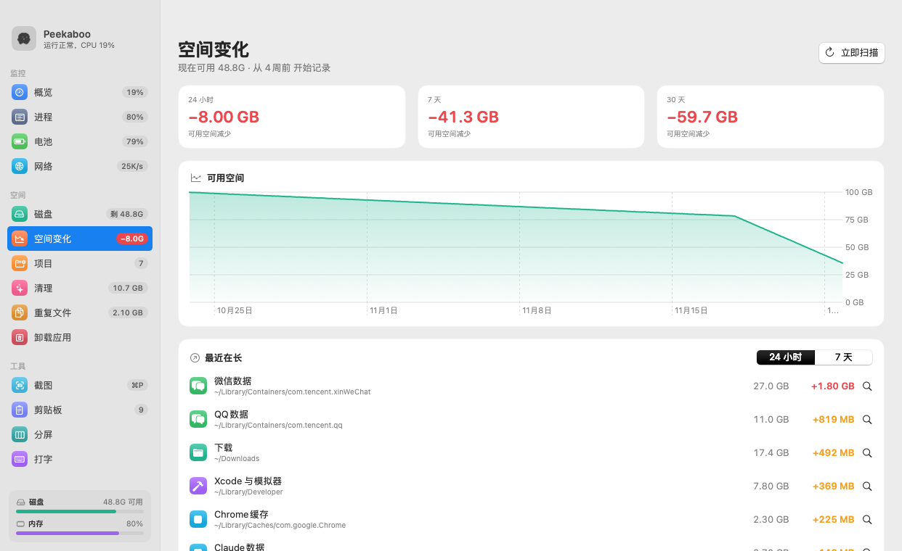

<p align="center"></p>

<h1 align="center">Peekaboo</h1>

<p align="center">
一只住在菜单栏里的小幽灵：系统监控、磁盘分析、安全清理、截图贴图、打字统计。<br>
A little ghost in your menu bar: system monitor, disk analyzer, safe cleaner, screenshots and typing stats.<br><br>
macOS 14+ · Windows 10/11 · 免费开源 Free & open source (MIT)
</p>

<p align="center">
<a href="#中文">中文</a> · <a href="#english">English</a> · <a href="https://github.com/zephyrusguooo028/Peekaboo/releases/latest">下载 Download</a>
</p>

<p align="center">

</p>

---

## 中文

### 有什么

| | |
|---|---|
| **菜单栏小图标** | 9 种动画图标（史莱姆、小幽灵、小鸡、小鲸鱼、火箭、心跳……），CPU 越忙跳得越快；旁边显示什么由你勾选：CPU、内存、磁盘剩余、网速、温度、GPU、电池、今日打字数 |
| **概览** | 实时曲线、每个核心的负载、过去 24 小时历史、内存构成 |
| **磁盘** | 方块图看清空间都去哪了，一层层点进去，右键直接移到废纸篓 |
| **项目** | 自动找出你的开发项目，分开显示源码、Git 历史、node_modules / dist 等可重新生成的东西 |
| **清理** | 开发缓存、项目依赖和构建产物、应用缓存、日志、下载里的旧文件、大文件；还能找出一直吃 CPU 或长时间闲置的大内存应用 |
| **重复文件** | 找出完全相同的文件和相似图片，智能保留最新的一份，其余移到废纸篓 |
| **卸载应用** | 卸载应用时连同它留在 Library / AppData 里的数据、缓存、偏好设置一起清掉 |
| **电池** | 健康度、循环次数、温度、功率，7 天电量记录，耗电大户估算 |
| **网络** | 每个应用的上传 / 下载速率和流量（Windows 显示每个应用的连接） |
| **截图** | 自定义快捷键，自动识别窗口，矩形 / 箭头 / 画笔 / 文字 / 马赛克（涂抹或框选，方块或模糊），**识字（OCR）**，复制、保存或贴在屏幕上 |
| **空间变化** | 每小时记录可用空间、每天量一次各个文件夹，告诉你**最近是什么在长**（微信、QQ、下载、缓存…）；一天少了 5 GB 以上会提醒；单独列出 macOS 自身和待安装的系统更新占了多少 |
| **剪贴板历史** | 复制过的文字、图片、链接、文件都留着，⌥⇧V（Windows Alt+Shift+V）随时调出搜索；自动跳过密码管理器的内容 |
| **分屏** | 类似 Magnet：⌃⌥ + 方向键 / 字母（Windows Ctrl+Alt）把窗口摆到半屏、四分之一、三分之一、铺满、居中、换屏；Mac 上把窗口拖到屏幕边缘也能自动分屏 |
| **打字统计** | 每天按键数、每小时分布、键盘热力图、最常用的键和应用。**只计数，从不记录内容** |
| **桌面小组件** | 常驻桌面的小浮窗：CPU、内存、磁盘、网速、电池、今日打字 |
| **其他** | 中英文界面、深色 / 浅色、8 种主题色、提醒、开机自启、应用内更新（新版本通知，可选空闲时自动安装） |

<p>


</p>
<p>


</p>

### 下载安装

到 [Releases](https://github.com/zephyrusguooo028/Peekaboo/releases/latest) 下载：

**macOS**（`Peekaboo.dmg`）

1. 双击打开 dmg，把 **Peekaboo** 拖到「应用程序」文件夹。
2. 第一次打开时 macOS 会提示「无法验证开发者」，因为 Peekaboo 没有付费的苹果开发者签名。打开 **系统设置 › 隐私与安全性**，在页面下方点「仍要打开」。
   也可以在终端里执行一次：`xattr -dr com.apple.quarantine /Applications/Peekaboo.app`
3. Peekaboo 只出现在菜单栏（右上角），不占程序坞。第一次打开会有一个权限引导窗口：监控和清理不需要任何权限，截图、打字统计、自动粘贴需要的权限可以在这里一次授权，需要重启生效时它会自己重启。
4. 以后有新版本，设置 › 更新 里点「下载并安装」就行。

**Windows**（`Peekaboo.exe`，单文件，不用安装）

1. 下载后双击运行。Windows 可能弹出「Windows 已保护你的电脑」，点「更多信息 › 仍要运行」（同样是因为没有付费代码签名）。
2. 图标在任务栏右下角的托盘里。Windows 11 会把新图标收进「^」里，可以把它拖到任务栏上常驻。
3. 想开机自启：设置 › 通用 › 开机时自动启动。

### 使用教程

**1. 菜单栏 / 托盘**
- 点小图标打开面板：CPU、内存、磁盘、网络，以及占用最高的应用。
- 设置 › 菜单栏 里挑一个喜欢的动画图标，勾选旁边要显示的数值。Windows 托盘不能显示文字，所以每个勾选的数值会单独占一个小图标。

**2. 磁盘**
- 点「扫描用户目录」，方块越大的文件夹越占空间；点方块进入，左上角返回。
- 右键任意方块：在 Finder 中显示、移到废纸篓、加入白名单（永不清理）。


**3. 项目**
- 默认在「文稿」「桌面」「Code」等目录里找项目（设置里可改）。
- `dist`、`build` 这类目录只有写在 `.gitignore` 里才算安全，否则会提示你确认，避免误删源码。

**4. 清理**
- 打开就会自动扫描，**扫描只读不删**。推荐项会默认勾选，点「清理所选」前会再确认一次。
- 默认「移到废纸篓」，可以恢复；清空废纸篓后才真正腾出空间。也可以选「直接删除」。
- 「释放内存和 CPU」：列出近几分钟一直很忙的程序，以及占内存大又很久没用的应用，勾选后像 ⌘Q 一样正常退出，不会强杀。
- 只会动你的用户目录；系统目录、受保护目录和白名单永远跳过。

**5. 截图**
- 默认快捷键 **⌥⇧A**（Windows 是 **Alt+Shift+A**），可以在「截图」页自己录制。
- 鼠标移到窗口上会自动高亮，单击截这个窗口；拖动自由框选。
- 第一排是工具，第二排是当前工具的选项：粗细和颜色、字号、马赛克的「涂抹 / 框选」和「马赛克 / 模糊」。
- 回车或双击 = 复制；⌘Z / Ctrl+Z 撤销；Esc 取消；右键重新框选。
- 「贴图」把截图钉在屏幕最上层：拖动移动、滚轮缩放、双击关闭、右键调透明度。
- macOS 第一次截图需要允许「屏幕录制」权限。


**6. 打字统计**
- 默认关闭。在「打字」页打开开关。
- macOS 需要允许「输入监控」权限：系统设置 › 隐私与安全性 › 输入监控 › 打开 Peekaboo。授权后页面会自动开始统计，没反应就点「重启 Peekaboo」。
- 只记录「哪个键按了几次、在哪个应用里」，不记录按键顺序，所以无法还原你打了什么。


**7. 剪贴板历史**
- 默认开启。按 **⌥⇧V**（Windows **Alt+Shift+V**）弹出快速面板，上下键选择、回车复制；可以在设置里换快捷键。
- 「剪贴板」页可以搜索、按类型筛选、置顶常用内容。密码管理器标记为「不要记录」的内容会自动跳过；历史只存在本机。
- 打开「选中后自动粘贴」后，选中会直接粘贴到当前应用（macOS 需要「辅助功能」权限）。

**8. 空间变化**
- 侧边栏「空间」›「空间变化」：上面是 24 小时 / 7 天 / 30 天少了多少和 30 天曲线，下面「最近在长」列出增长最多的文件夹（换成了看得懂的名字，比如「微信数据」）。第一天先列出目前最大的，第二天起就能对比。
- 「空间都去哪了」把已用空间分成三块：Peekaboo 量到的文件、macOS 自身（系统、启动和更新文件、恢复、交换），以及看不到的部分。下载好等待安装的 macOS 更新会单独说明，别手动删。
- macOS 的微信、QQ、照片、邮件等数据在受保护的文件夹里：在权限引导或这个页面开启「完全磁盘访问」后才能按应用量出来。只读大小，不读内容。



**9. 分屏**
- 默认快捷键和 Magnet 一样：⌃⌥←/→/↑/↓ 半屏，⌃⌥U/I/J/K 四个角，⌃⌥D/F/G 三分之一，⌃⌥E/T 三分之二，⌃⌥↩ 铺满，⌃⌥C 居中，⌃⌥⌫ 还原，⌃⌥⌘←/→ 移到另一块屏幕。Windows 把 ⌃⌥ 换成 Ctrl+Alt，换屏是 Ctrl+Alt+Win+←/→。
- 也可以像 Magnet 菜单那样用：点菜单栏图标（Windows 托盘图标），在弹窗的「分屏」里点一个布局，刚才在用的窗口就会摆过去。
- 「分屏」页可以改每个快捷键；点任意布局会把刚才在用的窗口摆过去。
- Mac 上拖动窗口到屏幕边缘会出现预览：左右边缘半屏，四个角四分之一，顶部铺满，底部三分之一；把分屏后的窗口拖走会恢复原来的大小。Windows 自带拖动分屏，所以 Windows 版只加了快捷键和三分之一布局。
- macOS 需要「辅助功能」权限，开启后立即生效，不用重启。


**10. 重复文件 / 卸载应用**
- 「重复文件」扫描下载、文稿、桌面、图片等目录，找出完全相同的文件（逐字节校验）和相似图片。每组至少保留一份，不可能全删。
- 「卸载应用」列出已安装的应用，选中后会找出它在 Library（Windows 是 AppData / ProgramData）里留下的数据。Mac 上一并移到废纸篓；Windows 会先运行应用自己的卸载程序，再清理残留。

**11. 电池 / 网络 / 桌面小组件**
- 「电池」显示健康度、循环次数和 7 天电量曲线（台式机没有这一项）。
- 「网络」显示每个应用的实时网速和累计流量（只在打开这个页面时采样）。
- 设置 › 桌面小组件 打开一个常驻桌面的小浮窗，可以拖动、选显示内容、调透明度。


**12. 设置**
- 语言（跟随系统 / 简体中文 / English）、主题色、动画图标、菜单栏内容、提醒阈值、清理规则、项目目录、白名单。

### 隐私

- 没有任何统计或上报。唯一的联网是检查更新：只读取 GitHub 上公开的版本信息，可以在 设置 › 更新 里关掉，关掉后完全不联网。所有数据只保存在本机：
  macOS `~/Library/Application Support/Peekaboo/`，Windows `%LocalAppData%\Peekaboo\`。
- 打字统计只计数，不记录内容；剪贴板历史只存本机并跳过密码管理器的内容；都可以随时一键清空。
- 代码全部开源，欢迎检查。

### 常见问题

- **打字统计一直显示「未开始」？** 到 系统设置 › 隐私与安全性 › 输入监控，确认 Peekaboo 已打开；如果列表里有旧条目，先点「−」删掉再重新授权，然后点「重启 Peekaboo」。
- **截图是黑的或者只有桌面？** 到 隐私与安全性 › 屏幕录制 允许 Peekaboo，然后重启它。
- **Windows 杀毒软件报毒？** 打字统计用的是全局键盘钩子，这项技术和键盘记录器相同，个别杀毒软件会误报。它默认关闭，只计数，代码可查。
- **内存清理为什么不是「一键释放」？** macOS 和 Windows 都会自动管理内存，强行清掉缓存只会让之后更慢。真正有效的是退出占用大、又没在用的应用，Peekaboo 帮你找出来。

### 从源码构建

macOS（只需要 Command Line Tools，不需要完整 Xcode）：

```bash
git clone https://github.com/zephyrusguooo028/Peekaboo.git
cd Peekaboo
./scripts/install.sh      # 构建并安装到 /Applications
./scripts/make-dmg.sh     # 打包 build/Peekaboo.dmg
```

Windows（.NET 8 SDK，在 macOS / Linux 上也能编译）：

```bash
cd windows/Peekaboo
dotnet publish -c Release -r win-x64 --self-contained true -p:PublishSingleFile=true -o out
```

每次推送，GitHub Actions 都会在 Windows 上编译并运行自检（读数、扫描、真实删除、模拟按键、截图编辑器）和每个页面的截图。

<details>
<summary>Windows 截图（浅色 / 深色）</summary>


</details>

---

## English

### Features

| | |
|---|---|
| **Menu bar icon** | 9 animated icons (slime, ghost, chick, whale, rocket, heart…) that move faster as the CPU gets busier. Pick what shows next to it: CPU, memory, free disk, network, temperature, GPU, battery, keystrokes today |
| **Overview** | Live charts, per-core load, 24-hour history, memory breakdown |
| **Disk** | Treemap of where your space went; click to drill in, right-click to move to Trash |
| **Projects** | Finds your code projects and splits source, Git history and regenerable folders like node_modules / dist |
| **Clean up** | Developer caches, project dependencies and build output, app caches, logs, old downloads, large files — plus apps that keep the CPU busy or sit idle using lots of memory |
| **Duplicates** | Exact duplicate files and similar photos; keeps one of each, moves the rest to the Trash |
| **Uninstall** | Removes an app together with what it left in Library / AppData |
| **Battery** | Health, cycle count, temperature, power draw, 7-day charge history, energy hogs |
| **Network** | Per-app upload / download rates and totals (per-app connections on Windows) |
| **Screenshot** | Custom hotkey, window snapping, rectangle / arrow / pen / text / mosaic (brush or box, pixelate or blur), **OCR**, copy, save or pin on screen |
| **Disk growth** | Records free space hourly and folder sizes daily, and shows **what has been growing** (chat apps, downloads, caches…); alerts when the disk loses 5 GB in a day; separates macOS's own volumes and pending system updates |
| **Clipboard history** | Everything you copy, searchable with ⌥⇧V (Windows Alt+Shift+V); password-manager content is skipped |
| **Window layout** | Magnet-style: ⌃⌥ + arrow / letter (Windows Ctrl+Alt) puts a window in a half, quarter, third, full screen, center or the next display; on Mac, dragging a window to a screen edge snaps it too |
| **Typing stats** | Keystrokes per day, per hour, keyboard heatmap, top keys and apps. **Counts only, never what you type** |
| **Desktop widget** | A small floating panel with CPU, memory, disk, network, battery and keystrokes today |
| **More** | Chinese / English UI, light / dark, 8 theme colours, alerts, launch at login, in-app updates (notification, optional automatic install when idle) |

<p>


</p>

### Install

Download from [Releases](https://github.com/zephyrusguooo028/Peekaboo/releases/latest).

**macOS** (`Peekaboo.dmg`): open it and drag **Peekaboo** to Applications. The app is not notarized, so the first launch is blocked: open **System Settings › Privacy & Security** and click **Open Anyway** (or run `xattr -dr com.apple.quarantine /Applications/Peekaboo.app`). Peekaboo lives in the menu bar only. On first launch a permissions window lists what each optional feature needs and restarts Peekaboo by itself when a permission only applies after a restart. Later versions install from Settings › Updates.

**Windows** (`Peekaboo.exe`, single file): run it; if SmartScreen appears, choose **More info › Run anyway**. The icon is in the notification area — on Windows 11 drag it out of the "^" overflow to keep it visible.

### How to use

- **Menu bar / tray** — click the icon for the quick panel. Settings › Menu bar picks the icon and the values shown next to it (on Windows each value gets its own small tray icon).
- **Disk** — scan your home folder, click blocks to drill in, right-click to reveal, trash or whitelist.
- **Clean up** — scanning never deletes anything. Recommended items are pre-selected; everything goes to the Trash by default. "Free up memory and CPU" quits selected apps like ⌘Q, never forced. Only your home folder is touched; protected and whitelisted locations are always skipped.
- **Screenshot** — default **⌥⇧A** (Windows **Alt+Shift+A**), re-recordable on the Screenshot page. Row 1 holds tools, row 2 the selected tool's options. Return / double-click copies, ⌘Z / Ctrl+Z undoes, Esc cancels, right-click re-selects. Pins can be dragged, zoomed with the wheel and closed with a double-click. macOS asks for Screen Recording permission the first time.
- **Clipboard** — ⌥⇧V / Alt+Shift+V opens the quick picker; the Clipboard page searches, filters and pins. Optional auto-paste needs Accessibility on macOS.
- **Disk growth** — Storage › Disk growth shows the 24 h / 7 d / 30 d change, a 30-day chart and the folders that grew most, with readable names. On day one it lists the largest folders; comparisons start the next day. On macOS, Full Disk Access is needed to measure protected app data (WeChat, QQ, Photos, Mail); sizes only, never contents.
- **Window layout** — Magnet's default shortcuts: ⌃⌥←/→/↑/↓ halves, ⌃⌥U/I/J/K quarters, ⌃⌥D/F/G thirds, ⌃⌥E/T two thirds, ⌃⌥↩ maximize, ⌃⌥C center, ⌃⌥⌫ restore, ⌃⌥⌘←/→ other display (Windows: Ctrl+Alt, and Ctrl+Alt+Win+←/→). Or click the menu bar icon (Windows tray icon) and pick a layout in the popover, like Magnet's menu. Every shortcut can be changed on the Window layout page. On Mac, drag a window to an edge (halves), corner (quarters), top (maximize) or bottom (thirds); Windows already snaps on drag. macOS needs Accessibility, which works without a restart.
- **Duplicates / Uninstall** — exact duplicates are verified byte-for-byte and one copy per group is always kept; the uninstaller also removes the app's leftovers (Windows runs the app's own uninstaller first).
- **Battery / Network / Widget** — battery health and history, per-app network traffic (sampled only while the page is open), and a floating desktop widget from Settings.
- **Typing** — off by default. macOS needs Input Monitoring permission (System Settings › Privacy & Security › Input Monitoring). Only per-key and per-app counts are stored, never key order.


### Privacy

No telemetry. The only network access is the optional update check, which reads public release info from GitHub (turn it off in Settings › Updates). Data stays on your machine (`~/Library/Application Support/Peekaboo/` or `%LocalAppData%\Peekaboo\`). Typing stats can be wiped any time.

### Build from source

```bash
git clone https://github.com/zephyrusguooo028/Peekaboo.git && cd Peekaboo
./scripts/install.sh       # macOS: build and install to /Applications (Command Line Tools are enough)
./scripts/make-dmg.sh      # macOS: build/Peekaboo.dmg
cd windows/Peekaboo && dotnet publish -c Release -r win-x64 --self-contained true -p:PublishSingleFile=true -o out
```

Developer flags: `--selftest`, `--snapshot <dir> [--demo]`, `--shot-demo <dir>`, `--icon-sheet <file>`.
On recent SDKs `@State` is a macro that ships only with full Xcode, so the views use a tiny `@Local` wrapper to build with the Command Line Tools alone.

## License

MIT
